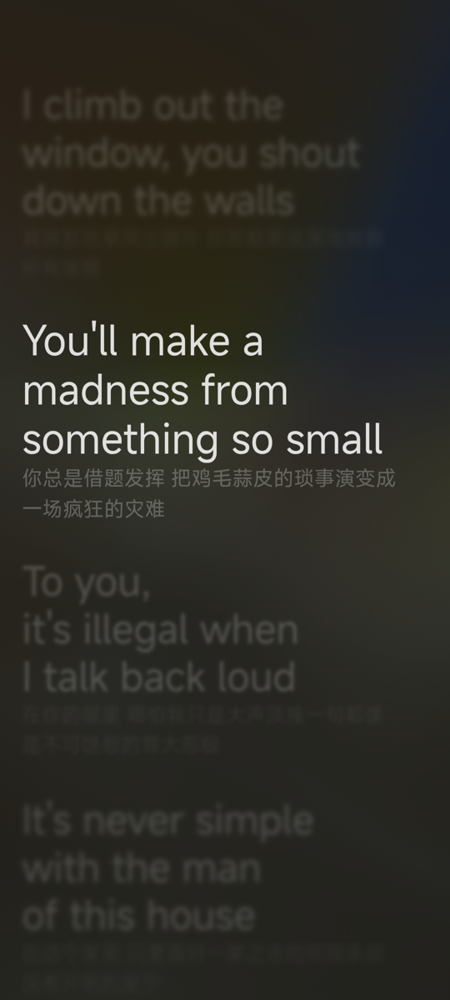
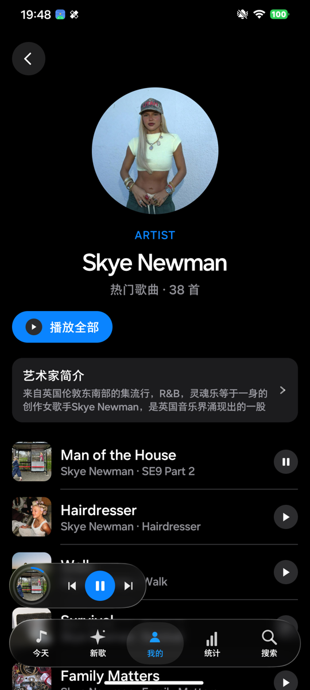
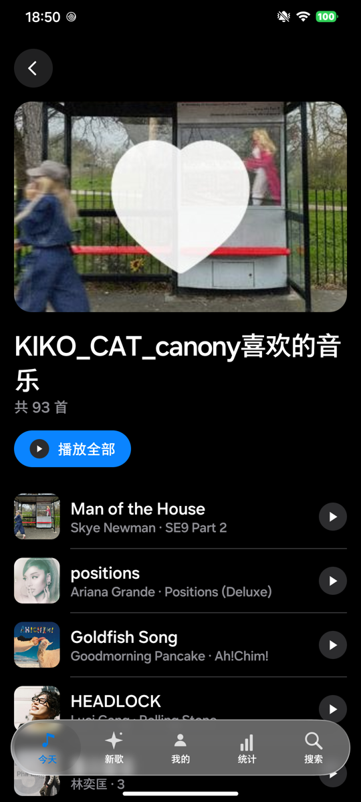
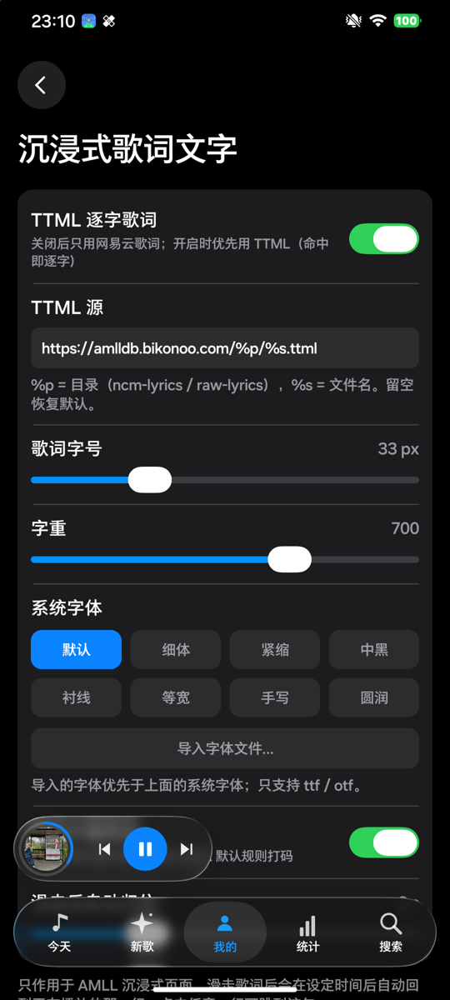

<div align="center">


# 音乐播放器 · ASMusic for Android

**Kotlin Multiplatform + Compose Multiplatform 的音乐播放器**

液态玻璃 UI · 逐字歌词 · 多源音源（JS 脚本）· Media3 播放内核

[功能](#功能) · [截图](#截图) · [构建](#构建) · [架构](#架构) · [许可证](#许可证)

</div>

> ⚠️ **本项目不是网易云音乐官方客户端**，与网易云音乐、Apple、AMLL 项目均无隶属关系。
> 仅用于个人学习与本地界面/播放链路研究，请使用你自己的账号，不要用于商业用途或二次分发版权内容。

## 功能

### 界面
- **液态玻璃（Liquid Glass）** 底栏、播放胶囊、弹层，基于自研 `backdrop` 模块（实时模糊 / 透镜 / 高光 / 阴影）
- **Haze 渐进模糊顶栏**：可调覆盖高度、过渡高度、模糊强度、暗色渐变，支持轻/标准/重预设
- **页面转场**：进入/退出页面时整体缩小 + 模糊 + 渐隐
- **界面大小**：8 级预设滑块（80%–130%）
- 深色主题、iOS 风格开关与滑块（`LiquidToggle` / `LiquidSlider`）

### 歌词
- **歌词卡片**：封面取色 + 程序化流光、点击跳转播放、长按进入沉浸式
- **沉浸式歌词**：接入 [AMLL](https://github.com/amll-dev/applemusic-like-lyrics)（AGPL-3.0）+ Pixi 流体背景
  - 逐字歌词（TTML / YRC，命中哪个用哪个）
  - 字号 / 字重 / 字体（系统内置 + 导入 ttf/otf）
  - 不雅用词遮挡开关、滑动浏览后自动归位（默认 1.5 s）
  - 点击任意歌词行立即跳转
- **歌词源**：AMLL TTML DB（CC0，可自定义镜像）→ 网易云 YRC → 酷狗 KRC 逐字（实验性，默认关闭）→ LRCLIB 行级兜底

### 播放
- Media3 / ExoPlayer 内核 + 媒体会话（通知栏、锁屏、蓝牙、流体云）
- **音源走 JS 脚本**（LX Music 协议 / 简易协议），Node.js 运行时执行，多源并发择优
- 播放队列 + 四种播放模式（顺序 / 循环 / 单曲 / 随机）
- 音质选择（标准 → 超清母带 8 档）+ WiFi / 移动网络默认音质
- **缓存**：音频缓存上限 512 MB–20 GB（多级）、下一首预缓存、整首缓存后再播放
- 播放进度条、系统媒体控制、网络异常后按播放键自动重试续播

### 其它
- 每日推荐、私人 FM、歌单、专辑、艺人页（真实头像 + 简介）、评论（最热/最新、玻璃弹层）
- 分享为图片（取色模糊流光背景）、歌单底部歌曲数/总时长统计
- 听歌统计、每周目标、缓存管理、自检自修复

## 截图

| 沉浸式歌词 | 艺人页 | 歌单 | 沉浸式歌词设置 |
|---|---|---|---|
|  |  |  |  |

## 构建

### 环境要求
| 项 | 版本 |
|---|---|
| JDK | 21（推荐 JetBrains Runtime 21） |
| Android SDK | compileSdk 见 `androidApp/build.gradle.kts` |
| Gradle | 随 `gradlew` 分发 |
| Node.js + pnpm | 仅构建 AMLL 离线包时需要（Node ≥ 20） |

### 1. 配置本地 SDK

```bash
# local.properties（已在 .gitignore 中）
sdk.dir=/path/to/Android/Sdk
```

### 2. 构建 AMLL 离线包（可选，仓库已包含产物）

```bash
cd web/amll
pnpm install
node build.mjs        # 输出到 androidApp/src/main/assets/amll/
```

### 3. 原生运行时（Node.js Mobile）

`androidApp/src/main/jniLibs/arm64-v8a/` 下需要三个 `.so`，合计约 50 MB：

| 文件 | 作用 |
|---|---|
| `libnode.so` | nodejs-mobile v18 运行时本体 |
| `libnode_exec.so` | ~4.5 KB 瘦壳，`main()` 只调 `node::Start()`，让 libnode 以独立子进程运行 |
| `libc++_shared.so` | libnode 的 C++ 运行时依赖 |

三者必须成套（同一构建、同一 ABI），不能从官方 nodejs-mobile release 里单独取——官方 zip 只有 `libnode.so`，且同一包里含多个 ABI，按文件名拷会互相覆盖。它们**已在版本库里**，clone 后即可编译；若缺失可用 `./scripts/fetch-node-libs.sh` 从发布 APK 里整取一套。

缺这三个文件时 App 仍可编译运行，只是「JS 音乐源脚本」不可用（设置 → 全面自检 会报「缺少 libnode_exec.so」）。

**16 KB 页对齐**：Android 15+ 的 16 KB 页设备要求每个 `.so` 的 `PT_LOAD` 段按 16 KB 对齐（`p_align ≥ 0x4000`，且 `p_offset ≡ p_vaddr (mod 16384)`）。`libnode.so` 是官方 4 KB 构建，仓库里的这一份已用 `scripts/align-elf-16kb.py` 重排过（只移动文件偏移、不改虚拟地址与段内容），并在真机上验证 node 可正常执行。替换该文件后请重跑：

```bash
python scripts/align-elf-16kb.py --check androidApp/src/main/jniLibs/arm64-v8a/libnode.so
```

注意 `jniLibs.useLegacyPackaging` 必须保持 `true`：Node 是以子进程方式运行的（`exec` 那个瘦壳），只有解压到 `nativeLibraryDir` 才能执行；改成 `false` 会让 JS 音源整体失效。

### 3.5 两套界面风格

应用内置两套完全独立的 UI，启动时读取偏好决定用哪一套，切换后需要重启：

| 风格 | 说明 | 设置入口 |
|---|---|---|
| 经典（iOS） | 毛玻璃、胶囊、大字标题；原有的界面与设置 | 设置 → 维护 → 界面风格 |
| Material 3 | `androidApp/.../md3/`：语义色 + 动态取色 + 弹簧动效 | 设置 → 界面风格 |

Material 3 那套是独立实现，不复用经典界面的布局。

**主题引擎**

- 种子色 → OKLCH → 26 个语义角色（含 5 档 surface 容器），超出色域时降 chroma 而不是截断。
- 6 种配色风格、3 种取色来源（跟随封面 / 手动调色相彩度 / 10 色预设）、3 档对比度、AMOLED 纯黑。
- 设置项全部是 Compose 快照状态：改完立刻重组生效，**不需要重启**（切换界面风格才需要）。

**Expressive 组件（自实现）**

`material3 1.4.0` 只提供了 `MaterialExpressiveTheme` 与 motion scheme，
组件层（ButtonGroup / FAB menu / FloatingToolbar / WavyProgress / SplitButton / LoadingIndicator）
在这一版还不存在，所以按官方 token 自己实现了一套，放在 `md3/Md3Expressive.kt`：

| 组件 | 尺寸 / 形状依据 |
|---|---|
| 按钮（5 档） | 高 32 / 40 / 56 / 96 / 136dp，圆角 12/12/16/28/28，**按下变方**（8/8/12/16/16） |
| Connected button group | 外侧整圆、内侧 4dp，选中段填充 + 对勾 + 药丸 |
| Split button | 两段之间 2dp，后缀恒为菜单图标 |
| FAB menu | 关闭态固定 56dp，展开一组带文字的动作 |
| Wavy progress / seek | 播放时波峰流动，暂停收成直线；拖动时定住 |
| Loading indicator | 38dp 可见形状 / 48dp 占位，圆形↔四角星 morph |
| Floating toolbar | 收起是单个 FAB，展开是一排操作 |

**播放页**（全部用上面的组件）

- 播放键形状 morph：静止 44dp 圆 → 按下收成 26dp 圆角；播放/暂停走 scale + fade。
- 上一首 / 下一首是 standard button group，按下时组内间距从 12 收到 2。
- 播放模式与「喜欢」用 split button：左执行、右展开；喜欢有真实状态（读 `likedIds`）。
- 进度条是波形，拖动时定住不发请求；整页支持下拉关闭。
- 歌词从底部半屏推上来，当前行高亮 + 自动居中 + 点行跳转。

**设置**（分类，不再是一页平铺）

```
设置
├── 账号
├── 界面风格（经典 / Material 3，切换即重启）
├── 搜索设置
├── 外观 ── 配色（风格 / 取色来源 / 明暗 / 对比度，带实时预览）
│          形状与排版（圆角预览、密度、字号，带字号示例）
│          动效（可点的弹簧预览 + 触觉开关）
│          布局（导航 / 首页 / 详情 / 标题栏，各带示意图）
├── 播放 ── 音质（Wi-Fi / 移动）、播放模式、进度条样式、呼吸封面、歌词
├── 音源 ── 直连开关、脚本导入 / 启用 / 删除（删除有确认）
├── 存储 ── 三类缓存占用、分项清理（有确认）、音频缓存上限
└── 关于与维护 ── 全面自检、重启、分组重置
```

父页每行右侧显示当前值摘要，二级页返回回到自己的父页；每组都有「恢复默认值」。

**2.2.0 起补充的能力**

- **自适应窗口**：MD3 启动时解除竖屏锁（经典界面仍锁竖屏），宽度 ≥600dp 换侧边导航轨（横屏高度 <480dp 时只留图标），内容最大宽度 840dp 居中。
- **逐字歌词**：按 yrc 的词级时间轴逐字上色，标题行标注「逐字」；拖动歌词时自动跟随暂停 3 秒。设置默认开启（`AppConfig.wordByWord` 的默认值也改成了 true —— 之前一直是 false，等于这条链路从未生效）。
- **播放队列可编辑**：打开自动定位当前曲，支持单曲移除与清空（保留正在播放的这首），都有二次确认。
- **搜索历史与分页**：历史最多 10 条（可单删/清空），结果滚到底自动加载下一页。
- **倍速与睡眠定时**：详情页 split button，0.5–2.0 倍速、15/30/60 分钟定时并显示剩余。
- **加入歌单**：「喜欢」的 split 菜单里，选一个自建歌单即可加入（需要登录）。
- **二级页返回保位**：路由状态用 `SaveableStateHolder` 保存，加上 `Md3PageCache` 内存缓存，从歌曲返回歌单不再跳回顶部。

**交互约定**

- 所有可点区域都走 `md3SurfaceClick`：状态层（按下 12% / 悬停 6%）+ 轻微收缩 + 触觉反馈，
  不再是「点了没反应」。
- 页面自己吃状态栏内边距，`Scaffold` 不再接管 `contentWindowInsets` —— 这是上一版
  「顶部一块空白顶栏占位」的根因。
- 图标全部来自官方 `androidx.compose.material:material-icons-extended`（Apache-2.0）。
- 配置隔离：MD3 的设置存在 `md3_app.xml`，与经典界面的 `music_app.xml` 互不影响。

> 依赖说明：Material 3 用 `androidx.compose.material3:material3:1.4.0`，并用
> `resolutionStrategy` 把 compose 系依赖统一到 1.12.1（与本工程 CMP 1.12.2 对齐）。

### 4. 编译

```bash
# Debug
./gradlew :androidApp:assembleDebug

# Release（需要签名，见下）
./gradlew :androidApp:assembleRelease
```

### 5. 签名（发布版）

仓库**不包含**签名密钥。自建一个即可：

```bash
keytool -genkeypair -v -keystore keys/appstore-release.jks \
  -alias appstore -keyalg RSA -keysize 2048 -validity 10000
```

然后在 `local.properties` 写入（不会入库）：

```properties
RELEASE_STORE_PASSWORD=你的密码
RELEASE_KEY_ALIAS=appstore
RELEASE_KEY_PASSWORD=你的密码
```

没有 `keys/appstore-release.jks` 时，release 会以未签名方式产出，不影响功能调试。

## 架构

```
appstore-compose/
├─ app/                 # Compose Multiplatform 共享 UI（commonMain / androidMain / skikoMain）
│  └─ src/commonMain/…/music/
│     ├─ MusicApp.kt            # 根组件、导航栈、沉浸式入口
│     ├─ SongDetailPage.kt      # 歌曲详情
│     ├─ LyricCards.kt          # 歌词卡片
│     ├─ AmlvImmersiveLyrics.kt # 沉浸式歌词（expect）
│     ├─ ArtistPage.kt          # 艺人页
│     ├─ AccountExtras.kt       # 设置页弹层（缓存/脚本/海报/目标）与通用设置控件
│     ├─ FineTunePage.kt        # 设置子页（按用户意图分 8 组）
│     └─ MusicBridge.kt         # UI ↔ 平台层接口（state + 业务方法）
├─ androidApp/          # Android 壳 + 播放/网络/脚本运行时
│  ├─ MusicBridgeImpl.kt        # 桥接实现（播放、缓存、账号、音源解析）
│  ├─ MusicPlayer.kt            # Media3 播放器 + SimpleCache
│  ├─ NeteaseDirect.kt          # 网易云 weapi/eapi 直连
│  ├─ ScriptEngine.kt           # JS 音源脚本
│  └─ src/main/assets/amll/     # AMLL + Pixi 离线包
├─ backdrop/            # 液态玻璃渲染库
├─ web/amll/            # AMLL 离线包构建工程（esbuild）
└─ docs/                # 任务书、历史 README
```

### 数据流

```
UI (Compose)  ── MusicBridge ──▶ MusicBridgeImpl
                                   ├─ NeteaseDirect / NodeSourceResolver → 音源 URL
                                   ├─ MusicPlayer (Media3 + SimpleCache)
                                   └─ ScriptEngine (Rhino / Node.js 执行 JS 音源)
```

## 已知限制

- 只支持 **arm64-v8a**（Node.js Mobile 运行时限制）
- 音频播放依赖 JS 音源脚本，**没有内置任何音源**
- 沉浸式歌词依赖 WebView + WebGL2（Android System WebView 需为现代版本）
- 部分歌曲在 TTML 库里没有条目，会退回网易云 YRC 或行级歌词

## 许可证

本项目以 **AGPL-3.0** 发布，主要原因是打包了 AMLL（AGPL-3.0）。
完整许可证见 [LICENSE](LICENSE)，第三方组件清单与合规说明见 [THIRD-PARTY-NOTICES.md](THIRD-PARTY-NOTICES.md)。

> 以 AGPL-3.0 发布意味着：任何分发本软件（含 APK）的行为，都必须同时提供完整对应源码，
> 并保留许可证与声明文件。

## 致谢

- [AMLL · Apple Music-like Lyrics](https://github.com/amll-dev/applemusic-like-lyrics)（AGPL-3.0）— 沉浸式歌词渲染与背景
- [AMLL TTML DB](https://github.com/amll-dev/amll-ttml-db)（CC0）— 逐字歌词数据
- [AndroidLiquidGlass](https://github.com/Kyant0/AndroidLiquidGlass)（Apache-2.0）— 液态玻璃组件
- [androidx.media3](https://github.com/androidx/media)、[Haze](https://github.com/chrisbanes/haze)、[Rhino](https://github.com/mozilla/rhino) 等

## 免责声明

本项目仅用于技术学习与研究。所有音乐、封面、歌词版权归各自权利人所有；本软件不存储、不分发任何音频文件，播放地址由第三方脚本在运行时解析。请支持正版音乐。因使用本软件产生的任何法律风险由使用者自行承担。
