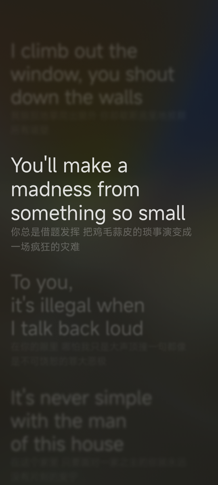
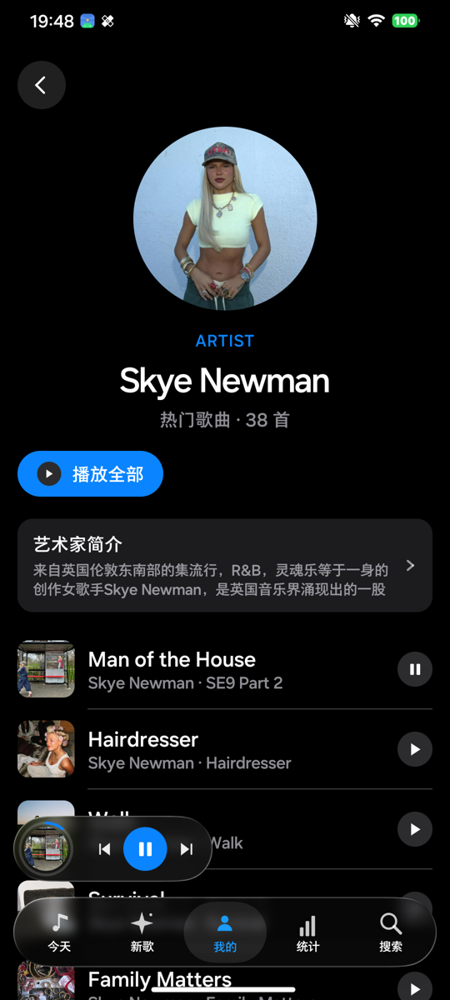
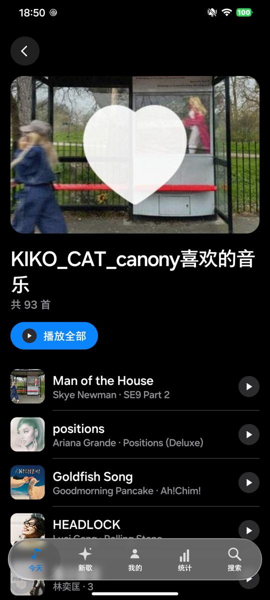
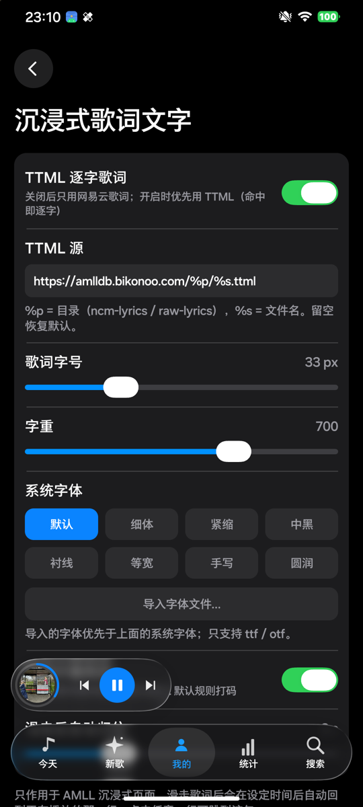

<div align="center">


# 音乐播放器 · ASMusic for Android

**Kotlin Multiplatform + Compose Multiplatform 的音乐播放器**

液态玻璃 UI · 逐字歌词 · 多源音源（JS 脚本）· Media3 播放内核

[功能](#功能) · [截图](#截图) · [构建](#构建) · [架构](#架构) · [许可证](#许可证)

</div>

> ⚠️ **本项目不是网易云音乐官方客户端**，与网易云音乐、Apple、AMLL 项目均无隶属关系。
> 仅用于个人学习与本地界面/播放链路研究，请使用你自己的账号，不要用于商业用途或二次分发版权内容。

## 功能

### 界面
- **液态玻璃（Liquid Glass）** 底栏、播放胶囊、弹层，基于自研 `backdrop` 模块（实时模糊 / 透镜 / 高光 / 阴影）
- **Haze 渐进模糊顶栏**：可调覆盖高度、过渡高度、模糊强度、暗色渐变，支持轻/标准/重预设
- **页面转场**：进入/退出页面时整体缩小 + 模糊 + 渐隐
- **界面大小**：8 级预设滑块（80%–130%）
- 深色主题、iOS 风格开关与滑块（`LiquidToggle` / `LiquidSlider`）

### 歌词
- **歌词卡片**：封面取色 + 程序化流光、点击跳转播放、长按进入沉浸式
- **沉浸式歌词**：接入 [AMLL](https://github.com/amll-dev/applemusic-like-lyrics)（AGPL-3.0）+ Pixi 流体背景
  - 逐字歌词（TTML / YRC，命中哪个用哪个）
  - 字号 / 字重 / 字体（系统内置 + 导入 ttf/otf）
  - 不雅用词遮挡开关、滑动浏览后自动归位（默认 1.5 s）
  - 点击任意歌词行立即跳转
- **歌词源**：AMLL TTML DB（CC0，可自定义镜像）→ 网易云 YRC → LRCLIB 行级兜底

### 播放
- Media3 / ExoPlayer 内核 + 媒体会话（通知栏、锁屏、蓝牙、流体云）
- **音源走 JS 脚本**（LX Music 协议 / 简易协议），Node.js 运行时执行，多源并发择优
- 播放队列 + 四种播放模式（顺序 / 循环 / 单曲 / 随机）
- 音质选择（标准 → 超清母带 8 档）+ WiFi / 移动网络默认音质
- **缓存**：音频缓存上限 512 MB–20 GB（多级）、下一首预缓存、整首缓存后再播放
- 播放进度条、系统媒体控制、网络异常后按播放键自动重试续播

### 其它
- 每日推荐、私人 FM、歌单、专辑、艺人页（真实头像 + 简介）、评论（最热/最新、玻璃弹层）
- 分享为图片（取色模糊流光背景）、歌单底部歌曲数/总时长统计
- 听歌统计、每周目标、缓存管理、自检自修复

## 截图

| 沉浸式歌词 | 艺人页 | 歌单 | 沉浸式歌词设置 |
|---|---|---|---|
|  |  |  |  |

## 构建

### 环境要求
| 项 | 版本 |
|---|---|
| JDK | 21（推荐 JetBrains Runtime 21） |
| Android SDK | compileSdk 见 `androidApp/build.gradle.kts` |
| Gradle | 随 `gradlew` 分发 |
| Node.js + pnpm | 仅构建 AMLL 离线包时需要（Node ≥ 20） |

### 1. 配置本地 SDK

```bash
# local.properties（已在 .gitignore 中）
sdk.dir=/path/to/Android/Sdk
```

### 2. 构建 AMLL 离线包（可选，仓库已包含产物）

```bash
cd web/amll
pnpm install
node build.mjs        # 输出到 androidApp/src/main/assets/amll/
```

### 3. 原生运行时（Node.js Mobile）

`androidApp/src/main/jniLibs/arm64-v8a/` 下需要 nodejs-mobile 的 `.so`。
这些 `.so` 已直接包含在仓库中（约 69 MB），clone 后即可编译。

### 4. 编译

```bash
# Debug
./gradlew :androidApp:assembleDebug

# Release（需要签名，见下）
./gradlew :androidApp:assembleRelease
```

### 5. 签名（发布版）

仓库**不包含**签名密钥。自建一个即可：

```bash
keytool -genkeypair -v -keystore keys/appstore-release.jks \
  -alias appstore -keyalg RSA -keysize 2048 -validity 10000
```

然后在 `local.properties` 写入（不会入库）：

```properties
RELEASE_STORE_PASSWORD=你的密码
RELEASE_KEY_ALIAS=appstore
RELEASE_KEY_PASSWORD=你的密码
```

没有 `keys/appstore-release.jks` 时，release 会以未签名方式产出，不影响功能调试。

## 架构

```
appstore-compose/
├─ app/                 # Compose Multiplatform 共享 UI（commonMain / androidMain / skikoMain）
│  └─ src/commonMain/…/music/
│     ├─ MusicApp.kt            # 根组件、导航栈、沉浸式入口
│     ├─ SongDetailPage.kt      # 歌曲详情
│     ├─ LyricCards.kt          # 歌词卡片
│     ├─ AmlvImmersiveLyrics.kt # 沉浸式歌词（expect）
│     ├─ ArtistPage.kt          # 艺人页
│     ├─ AccountExtras.kt       # 自定义页、缓存管理、弹层
│     └─ MusicBridge.kt         # UI ↔ 平台层接口（state + 业务方法）
├─ androidApp/          # Android 壳 + 播放/网络/脚本运行时
│  ├─ MusicBridgeImpl.kt        # 桥接实现（播放、缓存、账号、音源解析）
│  ├─ MusicPlayer.kt            # Media3 播放器 + SimpleCache
│  ├─ NeteaseDirect.kt          # 网易云 weapi/eapi 直连
│  ├─ ScriptEngine.kt           # JS 音源脚本
│  └─ src/main/assets/amll/     # AMLL + Pixi 离线包
├─ backdrop/            # 液态玻璃渲染库
├─ web/amll/            # AMLL 离线包构建工程（esbuild）
└─ docs/                # 任务书、历史 README
```

### 数据流

```
UI (Compose)  ── MusicBridge ──▶ MusicBridgeImpl
                                   ├─ NeteaseDirect / NodeSourceResolver → 音源 URL
                                   ├─ MusicPlayer (Media3 + SimpleCache)
                                   └─ ScriptEngine (Rhino / Node.js 执行 JS 音源)
```

## 已知限制

- 只支持 **arm64-v8a**（Node.js Mobile 运行时限制）
- 音频播放依赖 JS 音源脚本，**没有内置任何音源**
- 沉浸式歌词依赖 WebView + WebGL2（Android System WebView 需为现代版本）
- 部分歌曲在 TTML 库里没有条目，会退回网易云 YRC 或行级歌词

## 许可证

本项目以 **AGPL-3.0** 发布，主要原因是打包了 AMLL（AGPL-3.0）。
完整许可证见 [LICENSE](LICENSE)，第三方组件清单与合规说明见 [THIRD-PARTY-NOTICES.md](THIRD-PARTY-NOTICES.md)。

> 以 AGPL-3.0 发布意味着：任何分发本软件（含 APK）的行为，都必须同时提供完整对应源码，
> 并保留许可证与声明文件。

## 致谢

- [AMLL · Apple Music-like Lyrics](https://github.com/amll-dev/applemusic-like-lyrics)（AGPL-3.0）— 沉浸式歌词渲染与背景
- [AMLL TTML DB](https://github.com/amll-dev/amll-ttml-db)（CC0）— 逐字歌词数据
- [AndroidLiquidGlass](https://github.com/Kyant0/AndroidLiquidGlass)（Apache-2.0）— 液态玻璃组件
- [androidx.media3](https://github.com/androidx/media)、[Haze](https://github.com/chrisbanes/haze)、[Rhino](https://github.com/mozilla/rhino) 等

## 免责声明

本项目仅用于技术学习与研究。所有音乐、封面、歌词版权归各自权利人所有；本软件不存储、不分发任何音频文件，播放地址由第三方脚本在运行时解析。请支持正版音乐。因使用本软件产生的任何法律风险由使用者自行承担。
